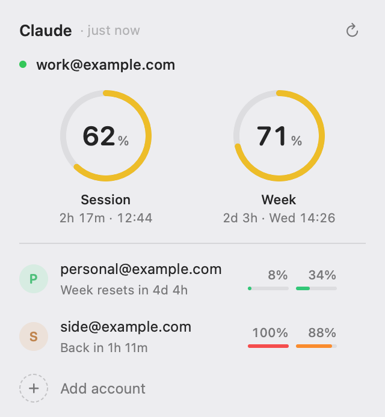
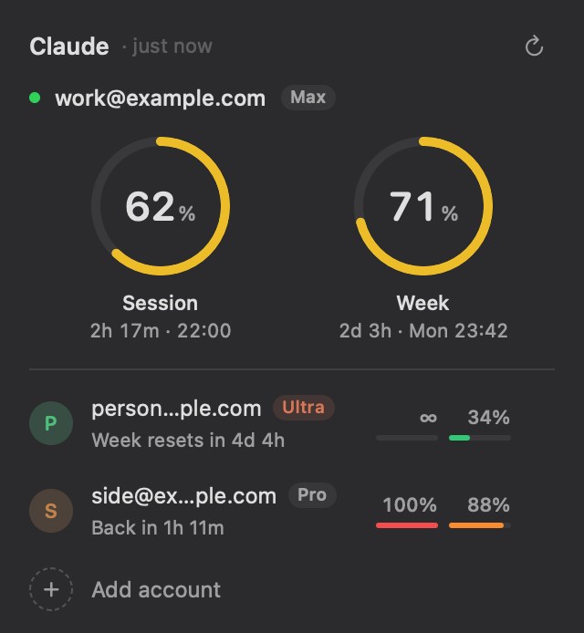

<p align="center"></p>

<h1 align="center">Claude Van Dam</h1>

<p align="center">A macOS menu bar app for people with more than one Claude account.<br>
See your limits at a glance, switch in one click, and let it switch for you before a session runs dry.</p>

<p align="center">
  
  
</p>

## Features

- **Limits in the menu bar.** Two bars, one for the 5-hour session and one for the week, plus the
  tighter of the two as a number. 
- **One-click switching.** Click an account to make it Claude Code's login. Running sessions pick it
  up within about 30 seconds.
- **Auto-switch** (off by default). When the active account reaches 95% (or looks set to hit 100%
  before the next check), the app moves to the account with the most headroom and sends a
  notification. You can set the threshold to 90, 95, 98 or 99%.
- **Fresh tokens.** Expired logins on inactive accounts are renewed, so their numbers stay current.
- **Accounts.** Add one, log back in to a signed-out account, remove one, and export or import the
  whole set. Logging in opens a private window that uses none of your browser's sign-ins and approves
  Claude Code's access once you're signed in. For an email login, paste the link from the email into
  the window: it reads the code from it and enters it. A button there hands the page to your browser
  instead (for a passkey, say).
- **Keep awake.** Stops the Mac from sleeping while work runs. The display can still turn off and lock.

Left-click the icon to open the popover. Right-click it for settings: Auto-Switch, Keep Awake,
Launch at Login, the menu bar label, Export/Import and Quit.

## Install

Needs macOS 14+ and [Claude Code](https://docs.anthropic.com/en/docs/claude-code) (adding an account
runs `claude auth login`).

**Homebrew**

```bash
brew tap aspasskiy/claude-van-dam https://github.com/aspasskiy/claude-van-dam
brew install --cask aspasskiy/claude-van-dam/claude-van-dam
```

Update with `brew upgrade --cask claude-van-dam`, remove with `brew uninstall --cask claude-van-dam`.

**Download.** Get `Claude-Van-Dam-<version>.dmg` from [Releases](https://github.com/aspasskiy/claude-van-dam/releases),
open it and drag Claude Van Dam to Applications (a `.zip` with the same app is there too). Releases
are signed with Developer ID and notarized by Apple, so they open without Gatekeeper warnings.

**From source.** Needs Swift 6 (Xcode or the command line tools).

```bash
./build.sh --install   # builds "Claude Van Dam.app", copies it to /Applications and launches it
```

A source build is signed ad hoc and only meant for your own Mac.

## How it works

- Claude Code's own login lives in the Keychain item `Claude Code-credentials`. Switching swaps that
  item and the `oauthAccount` block of `~/.claude.json` for a saved copy, under the same locks
  Claude Code takes, so it never writes over a token Claude Code is refreshing.
- Saved accounts live in `~/.claude-swap-backup` (roster, profiles, usage cache) and in the login
  Keychain (service `claude-swap`, one item per account).
- All Keychain access goes through `/usr/bin/security`, the binary those items trust, so Claude Code
  can keep reading its login without prompts. A secret normally reaches `security` on stdin; a very
  long one (a login carrying large MCP OAuth data) is passed as an argument instead, which other
  processes of your user can see in `ps` for that moment.
- Usage comes from `api.anthropic.com/api/oauth/usage`, polled every 1–30 minutes per account
  (faster for the active account near the threshold, slower after a 429).
- The only network traffic is to Anthropic: the usage and profile endpoints on `api.anthropic.com`
  and the OAuth token endpoint on `platform.claude.com`.
- `CLAUDE_CONFIG_DIR` profiles aren't supported: with it set, the app won't fetch, switch or change accounts.

This is an unofficial tool, not affiliated with or endorsed by Anthropic. It relies on undocumented
endpoints that can change without notice.

## Development

| Path | What's there |
| --- | --- |
| `Sources/SwapCore` | Accounts, Keychain, locks, switching, token refresh, usage polling, auto-switch policy |
| `Sources/ClaudeVanDam` | The app: status item, SwiftUI popover, settings menu |
| `Sources/claude-van-dam-cli` | Terminal harness: `list`, `refresh`, `add`, `switch N`, `rotate`, `best`, `auto`, `remove N`, `export`, `import` |
| `Tests/SwapCoreTests` | Auto-switch decision tests (`swift test`) |
| `Casks/claude-van-dam.rb` | Homebrew cask (this repo doubles as its tap) |
| `tools/make-icon.swift` | Draws `Resources/AppIcon.png`; `build.sh` turns it into the `.icns` |

```bash
swift build && swift test
swift run claude-van-dam-cli list
```

`./build.sh --release` signs the app with Developer ID, notarizes it and writes
`build/Claude-Van-Dam-<version>.zip` and `.dmg` for the release, with their SHA-256 (the zip's goes
into `Casks/claude-van-dam.rb`).

## License

MIT, see [LICENSE](LICENSE).
